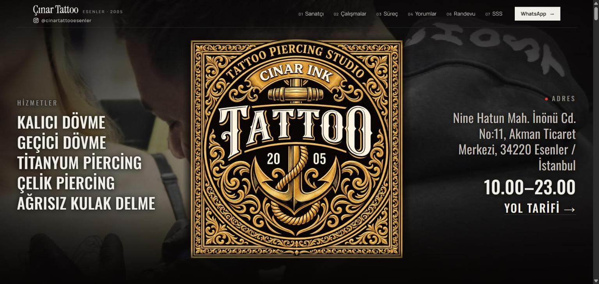

# Çınar Tattoo

**Canlı site:** [cinartattooesenler.com](https://cinartattooesenler.com)

Esenler'deki Çınar Tattoo dövme ve piercing stüdyosu için hazırladığım web sitesi ve yönetim paneli.



## Neler var

- **Tek sayfalık site:** Sanatçı, çalışmalar, süreç, Google yorumları, randevu ve sık sorulan sorular bölümleri. Telefonda ve bilgisayarda düzgün görünür, animasyonlu ve sade bir tasarımla yapıldı.
- **Yönetim paneli (`/admin`):** Stüdyo sahibi telefonundan fotoğraf, hizmet, fiyat, yorum ve sitedeki bütün yazıları kendisi değiştirir. Panel telefonun ana ekranına uygulama gibi eklenebilir ve her açılışta şifre ister.
- **Tıklama sayacı:** Ziyaretçilerin WhatsApp, arama ve yol tarifi düğmelerine kaç kez bastığını panelde gösterir.
- **Yerel SEO:** Google'ın işletmeyi tanıması için yapılandırılmış veri (TattooParlor), site haritası ve arama motoru ayarları.

## Teknik

- Saf JavaScript, HTML ve CSS; npm bağımlılığı ve build adımı yok. Animasyonlar için anime.js.
- Cloudflare Pages + Pages Functions; içerik D1'de, panelden yüklenen fotoğraflar KV'de.
- Yerelde Cloudflare yerine Node'un yerleşik modülleriyle yazılmış küçük bir emülatör çalışır (`dev/`).
- ~600 birim testi ve başsız tarayıcıyla uçtan uca deneme.

```bash
cp .dev.vars.example .dev.vars   # bir kez; şifreyi ve APP_SECRET'i değiştir
npm run dev       # http://127.0.0.1:8788  (panel: /admin/)
npm test          # birim testleri
npm run e2e       # uçtan uca deneme
```

Yayına alma adımları: [docs/KURULUM.md](docs/KURULUM.md)

Claude Code yardımıyla geliştirildi.

## Lisans

Tüm hakları saklıdır. Kod yalnızca incelemek için yayımlanmıştır; izinsiz kopyalanamaz, kullanılamaz ya da dağıtılamaz. Ayrıntı: [LICENSE](LICENSE)

Fotoğraflar, logo ve işletme bilgileri Çınar Tattoo'ya aittir.
